<!-- cool-readme:start -->
<!-- Cards by github-cool-readme: https://github.com/pedrocatalao/github-cool-readme -->

<picture>
  <source media="(prefers-color-scheme: dark)" srcset="https://raw.githubusercontent.com/novruzoff/novruzoff/cards/about-dark.svg">
  
</picture>
<picture>
  <source media="(prefers-color-scheme: dark)" srcset="https://raw.githubusercontent.com/novruzoff/novruzoff/cards/languages-dark.svg">
  
</picture>
<picture>
  <source media="(prefers-color-scheme: dark)" srcset="https://raw.githubusercontent.com/novruzoff/novruzoff/cards/summary-dark.svg">
  
</picture>
<picture>
  <source media="(prefers-color-scheme: dark)" srcset="https://raw.githubusercontent.com/novruzoff/novruzoff/cards/weekly-dark.svg">
  
</picture>
<picture>
  <source media="(prefers-color-scheme: dark)" srcset="https://raw.githubusercontent.com/novruzoff/novruzoff/cards/streaks-dark.svg">
  
</picture>
<picture>
  <source media="(prefers-color-scheme: dark)" srcset="https://raw.githubusercontent.com/novruzoff/novruzoff/cards/contributions-dark.svg">
  
</picture>

<!-- cool-readme:end -->

# Skills

### Languages:

### Frameworks and Software:

---

# Contact

- Check out my [Website Portfolio](https://novruzoff.dev)
- Connect on [LinkedIn](https://www.linkedin.com/in/novruzovmurad/)
- Email me at: [murad@novruzoff.dev](mailto:murad@novruzoff.dev)
