# About
**@novruzoff** - Full-Stack Developer and Computer Science Student at McGill University in Canada
  
---

# Stats

<!--
  Stat cards generated every 2 hours by .github/workflows/cool-readme.yml and served
  from the orphan `cards` branch. Each <picture> shows the dark SVG on GitHub's dark
  theme and the light SVG otherwise. Wide cards are 450px, narrow 350px: each pair sits
  side by side on desktop and stacks on mobile. Keep the two <picture> tags of a row
  together with no blank line between them.
-->

<!-- Row 1: summary (wide) + languages (narrow) -->
<picture>
  <source media="(prefers-color-scheme: dark)" srcset="https://raw.githubusercontent.com/novruzoff/novruzoff/cards/summary-dark.svg">
  
</picture>
<picture>
  <source media="(prefers-color-scheme: dark)" srcset="https://raw.githubusercontent.com/novruzoff/novruzoff/cards/languages-dark.svg">
  
</picture>

<!-- Row 2: notable contributions (wide) + weekly rhythm (narrow) -->
<picture>
  <source media="(prefers-color-scheme: dark)" srcset="https://raw.githubusercontent.com/novruzoff/novruzoff/cards/contributions-dark.svg">
  
</picture>
<picture>
  <source media="(prefers-color-scheme: dark)" srcset="https://raw.githubusercontent.com/novruzoff/novruzoff/cards/weekly-dark.svg">
  
</picture>

---

# Skills

### Languages:

### Frameworks and Software:

---

# Contact

- Check out my [Website Portfolio](https://novruzoff.github.io/#/)
- Connect on [LinkedIn](https://www.linkedin.com/in/novruzovmurad/)
- Email me at: [murad.novruzov1899@gmail.com](mailto:murad.novruzov1899@gmail.com)
